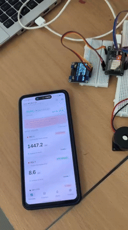
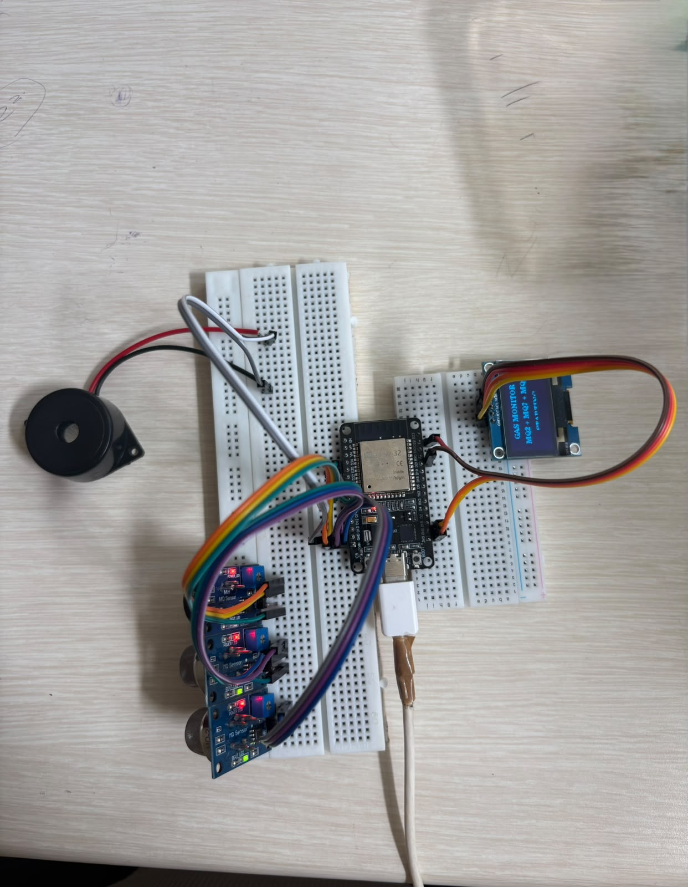
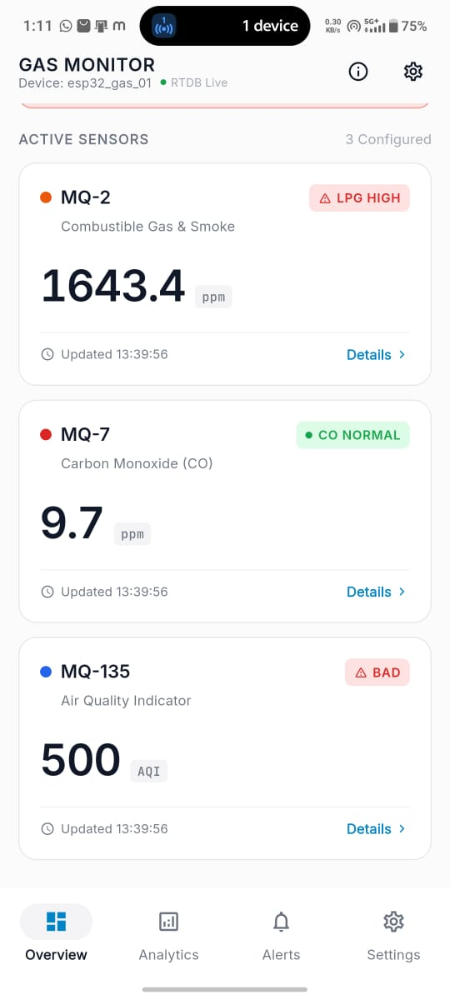
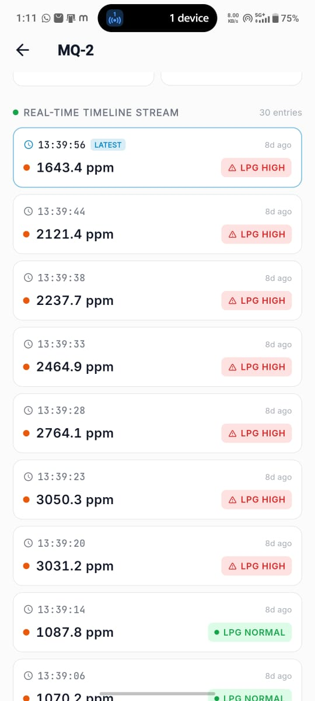
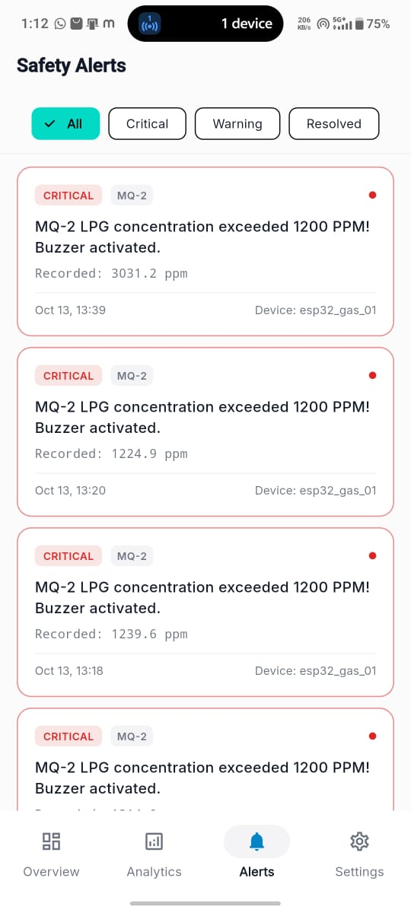
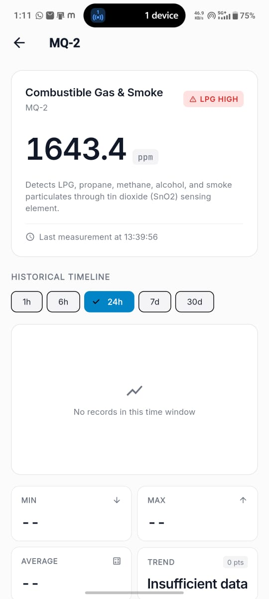
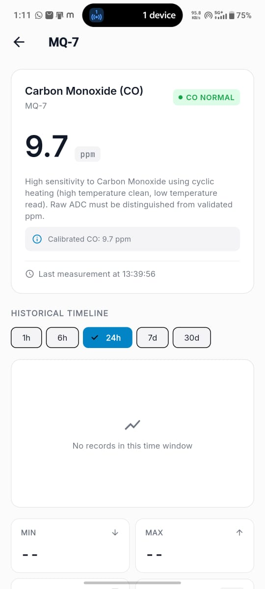
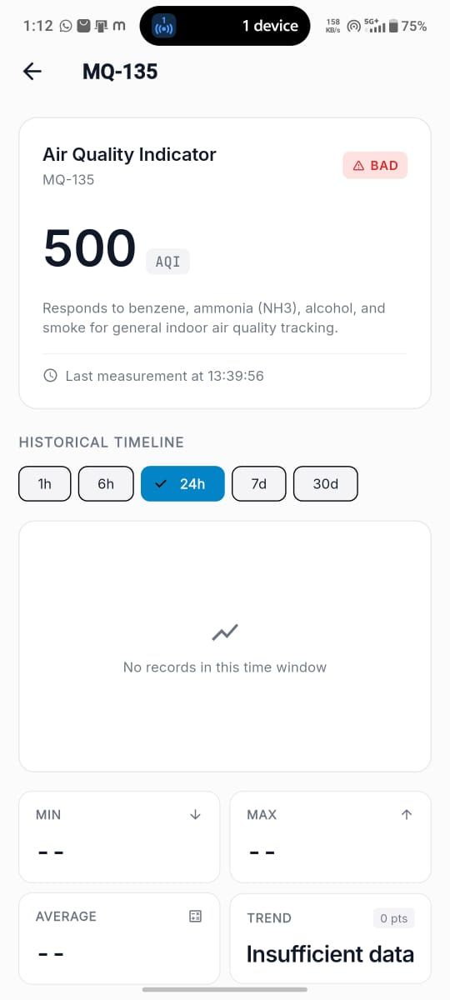
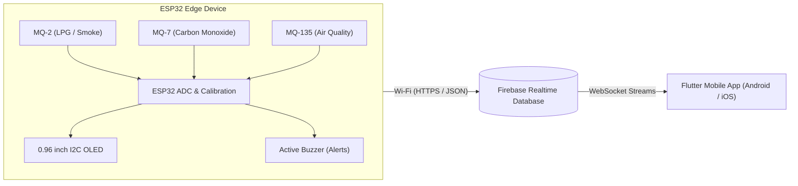

# 🚨 Smart IoT Harmful Gas Detection & Real-Time Monitoring System

An end-to-end IoT safety and hazardous gas monitoring solution combining **ESP32 microcontroller firmware**, multi-gas sensors (**MQ-2, MQ-7, MQ-135**), **Firebase Realtime Database (RTDB)**, and a modern **Flutter mobile application** for live telemetry, historical streams, and automated safety alerts.

---

## 🎬 Working Demonstration

### Live Hardware & App Demonstration (Preview)


> 📹 **Muted Full Demo Video**: [Watch / Download Video](docs/media/live_demo_working.mp4) | [Google Drive HD Backup](https://drive.google.com/file/d/1Rgp8bufG_bikZTK2F3liAyf0pnKcQkuH/view?usp=drivesdk)

---

## ⚡ Hardware Architecture & Circuit Setup

The hardware module connects three analog electrochemical gas sensors, a 0.96" I2C OLED display, and an active buzzer to an ESP32 microcontroller board.

<p align="center">
  
</p>

### Sensor Specifications & Thresholds
| Sensor | Target Gases | Real Unit | Safety Thresholds & States |
| :--- | :--- | :--- | :--- |
| **MQ-2** | LPG, Propane, Hydrogen, Methane, Smoke | **PPM** | • Normal: $\le 1200\text{ ppm}$<br>• Critical / Buzzer: $> 1200\text{ ppm}$ (`LPG HIGH`) |
| **MQ-7** | Carbon Monoxide (CO) | **PPM** | • Normal: $\le 35\text{ ppm}$<br>• Warning: $36 - 99\text{ ppm}$<br>• Hazardous: $\ge 100\text{ ppm}$ |
| **MQ-135** | Air Quality Index (NH3, NOx, Alcohol, Benzene, CO2) | **AQI** | • Good: $\le 90\text{ AQI}$<br>• Medium: $91 - 129\text{ AQI}$<br>• Bad: $\ge 130\text{ AQI}$ |

---

## 📱 Mobile Application Features & Screenshots

The Flutter mobile application provides real-time sensor streams via Firebase RTDB, interactive historical logs, and immediate alert notification logging.

### App Screen Gallery

| Overview Dashboard | Real-Time Timeline Stream | Safety Alert Logs |
| :---: | :---: | :---: |
|  |  |  |

| MQ-2 Combustible Gas | MQ-7 Carbon Monoxide | MQ-135 Air Quality (AQI) |
| :---: | :---: | :---: |
|  |  |  |

### Key App Capabilities
- 🔄 **Real-Time Synchronous Telemetry**: Instant updates from Firebase RTDB with freshness indicator.
- 📊 **Historical Timeline Stream**: Paginated logs with timestamp, exact readings, and status badges.
- 🚨 **Instant Hazard Alerts**: Critical thresholds activate local buzzers and log timestamped safety alerts in the app.
- 📈 **Responsive & Adaptive UI**: Zero overflow on all screen dimensions with clean typography and dark/light contrast.

---

## 🏗️ System Architecture



---

## 🚀 Getting Started

### 1. Clone the Repository
```bash
git clone https://github.com/cyberidfc9/HARMFUL-GAS-DETECTER.git
cd HARMFUL-GAS-DETECTER
```

### 2. Flashing the ESP32 Firmware
1. Open Arduino IDE.
2. Open `firmware/esp32_gas_monitor/esp32_gas_monitor.ino`.
3. Install required libraries:
   - `Adafruit SSD1306` & `Adafruit GFX`
   - `Firebase ESP32 Client`
4. Set your Wi-Fi credentials and Firebase RTDB URL in `esp32_gas_monitor.ino`.
5. Connect your ESP32 via USB and click **Upload**.

### 3. Running the Flutter Mobile App
1. Ensure Flutter 3.x+ is installed:
   ```bash
   flutter doctor
   ```
2. Install dependencies:
   ```bash
   flutter pub get
   ```
3. Run on connected phone or emulator:
   ```bash
   flutter run
   ```
4. Or build the release/debug APK:
   ```bash
   flutter build apk --debug
   ```

---

## 📄 License
This project is open-source and available under the [MIT License](LICENSE).
